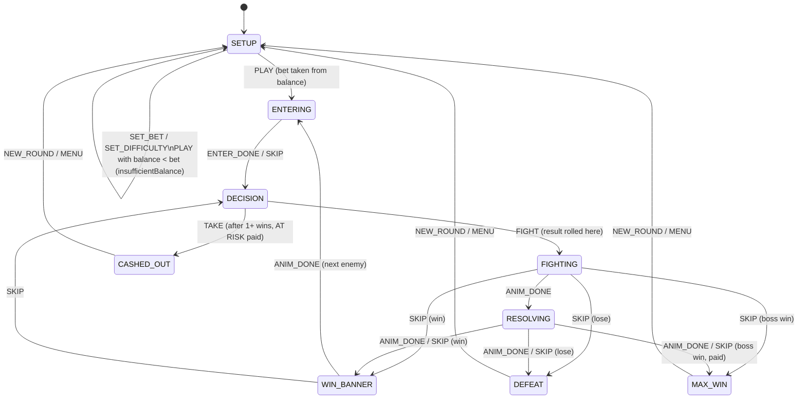

# Game rules

Code: `prototype/src/game/` (`config.js`, `money.js`, `rng.js`, `machine.js`, `useGame.js`).

## Rules

1. Before a round, pick a **bet** (chips 1 / 2 / 5 / 10 / MAX, or the stepper) and a **difficulty** (Easy / Medium / High).
2. **PLAY** takes the bet from the balance. From then until the round ends, the bet and difficulty cannot change.
3. The knight fights enemies one at a time. Every fight is won with the difficulty's win chance. The result is rolled when you press FIGHT, so animations only replay a result that is already known.
4. Each won fight passes a **gate**, and each gate has a multiplier.
   - **AT RISK** (= TAKE) = bet × multiplier of the last gate passed. Before the first win it is 0, and TAKE is disabled.
   - **NEXT** = multiplier of the next gate.
   - **IF WON** = bet × NEXT.
5. **FIGHT**: if you win, you move to the next gate. If you lose, the round ends with **DEFEAT** and the bet is lost.
6. **TAKE**: ends the round with **CASHED OUT** and adds AT RISK to the balance.
7. The **last gate is the boss**. Beating it ends the round automatically with **MAX WIN** = bet × final multiplier.
8. After any ending, **NEW ROUND** returns to setup with the same bet and difficulty.
9. **SKIP** jumps any animation straight to its end result.

All money is rounded to cents once, in `money.js`. The same `?seed=` always plays the same sequence of fights.

## State diagram

Events that do not apply in the current state are ignored. This is how buttons stay locked during animations.

## Placeholders

Every number below lives in `config.js`, marked `PLACEHOLDER - pending client`.

| Setting | Value | Source |
| --- | --- | --- |
| Starting balance | 40.00 | Figma 587:5125 |
| Default bet | 5.00 | Figma 587:5125 |
| Bet chips | 1, 2, 5, 10, MAX | Figma 587:5125 |
| Min / max bet | 1 / 20 (MAX = min(20, balance)) | assumption |
| Win chance | Easy 80% · Medium 65% · High 45% | old prototype, Figma "win ~65%" |
| Gates per round | 7 (gate 7 = boss) | Figma 660:5112 (Gate 9 label, 7 values) |
| Medium gates | ×1.20 · ×1.60 · ×2.40 · ×3.90 · ×6.80 · ×11.50 · ×19.00 | Figma 472:7862 … 473:1307, 473:1397 |
| Easy gates | ×1.10 · ×1.30 · ×1.55 · ×2.00 · ×2.70 · ×3.55 · ×4.60 | Medium^0.518, rounded to 0.05 |
| High gates | ×1.40 · ×2.40 · ×5.05 · ×12.45 · ×34.95 · ×92.50 · ×234.60 | Medium^1.854, rounded to 0.05 |
| Max win (bet 5) | Easy 23.00 · Medium 95.00 · High 1,173.00 | derived |

### Medium round, bet 5 (matches the Figma level frames)

| After wins | AT RISK | NEXT | IF WON |
| --- | --- | --- | --- |
| 0 | 0.00 | ×1.20 | 6.00 |
| 1 | 6.00 | ×1.60 | 8.00 |
| 2 | 8.00 | ×2.40 | 12.00 |
| 3 | 12.00 | ×3.90 | 19.50 |
| 4 | 19.50 | ×6.80 | 34.00 |
| 5 | 34.00 | ×11.50 | 57.50 |
| 6 (boss next) | 57.50 | ×19.00 | 95.00 |
| 7 (boss beaten) | MAX WIN +95.00 | — | — |

## Debug

- The `D` key toggles the debug panel. It shows the state, balance, bet, difficulty, level, AT RISK, IF WON and seed, plus a button for every event and force win / force lose (applies to the next fight only).
- `?seed=123` in the URL replays the same round every time.
